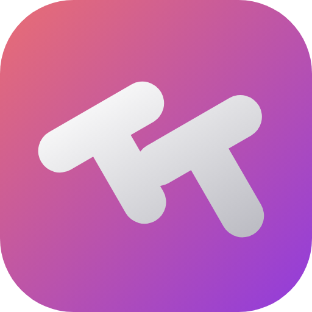
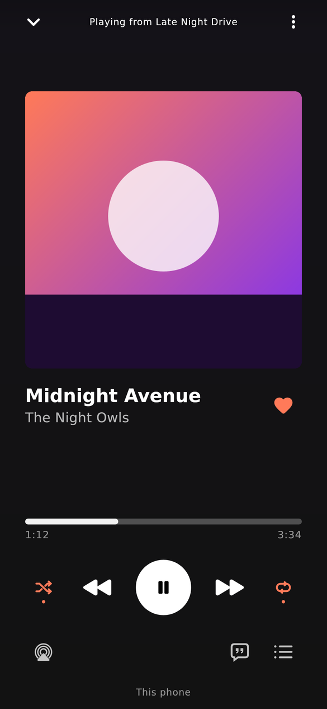
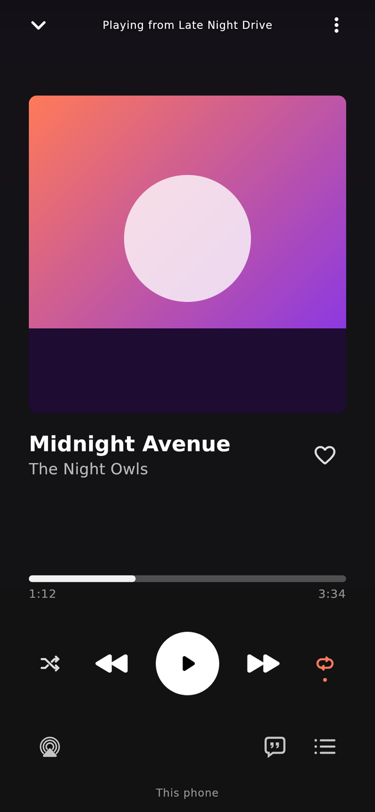

 
 

# TuneTable

### Music, your way

 

TuneTable is a modified version of [**BitChord**](https://github.com/kushagrasinghx/BitChord) by [kushagrasinghx](https://github.com/kushagrasinghx). [Support the original author ↓](#credits)

 

[**Features**](#features) · [**What's new**](#whats-new) · [**Download**](#download) · [**Credits**](#credits) · [**Disclaimer**](#disclaimer)

 

&nbsp;&nbsp;

Preview renders of the now playing screen, with sample cover art.

> [!IMPORTANT]
> TuneTable is not affiliated with, endorsed by, or connected to YouTube or Google in any way. Use it at your own discretion.

---

<h1>What's new in TuneTable</h1>

- **Spotify-style now playing screen** — big cover art, bold title with a heart to like, shuffle and repeat beside a round play button, and the cover's colour fading down to black behind it.
- **Your own accent colour** — the app icon's coral-to-purple gradient, your phone's system colours, a set of presets, or any colour you pick. Highlights, switches, selected items and the app's background all follow it.
- **A new Home** — a greeting for the time of day, filters for songs, videos and mixes, your playlists one tap away, a "Jump back in" card for the album or playlist you were last playing, and recently played as a grid.
- **Folding bars** — scroll down and the tab bar folds into a single button at the bottom-left while the mini player slides in beside it; scroll up and both unfold.
- **Redesigned Settings** — cards washed in your accent, round gradient icons and clearer section headings.
- **A cleaner, solid look** — the frosted-glass effects are gone.
- **Smaller touches** — a heart for Like everywhere, sliding page transitions, a tidier account menu, and a new icon.

---

<h1>Features</h1>

<table>
  <tr>
    <td width="50%" valign="top">

#### Playback
- **Search, browse and play** anything available on YouTube Music.
- **Hi-Res lossless audio** — FLAC/ALAC from a configured module source, with YouTube Music as fallback.
- **Gapless playback with true crossfade**, adjustable 0–12s.
- **Automix [Beta]** — DJ-style transitions with beat-matching and tempo-stretching.
- **Offline downloads** — save tracks with embedded metadata.
- **Local music library** integration.
- **Background playback** via a proper foreground media session.
- **Apple-like lyrics animation** — credit to [binimum](https://github.com/binimum/am-lyrics).

#### Connectivity & Accounts
- **Sign in with your Google account** for personalized content.
- **Spotify integration** — connect your account to play your playlists and Liked Songs.
- **Discord Rich Presence** — in-app login, live track/artist/album and progress.
- **Scrobbling** to Last.fm and ListenBrainz.
- **Pluggable sources** — add, edit, test and health-check module sources.

    </td>
    <td width="50%" valign="top">

#### Experience
- **Animated album canvas** — motion artwork on the now-playing screen.
- **Word-synced lyrics** — word/syllable-level highlighting from multiple sources.
- **Lyrics providers** — credit to [lrc.red](https://lrc.red), [BiniLyrics](https://github.com/binimum), [BetterLyrics](https://github.com/better-lyrics/better-lyrics), [PaxSenix](https://lyrics.paxsenix.org), [LyricsPlus](https://github.com/ibratabian17/YouLyPlus), [SimpMusic](https://github.com/maxrave-dev/SimpMusic), [Unison](https://unison.boidu.dev), [Megalobiz](https://www.megalobiz.com), [KuGou](https://www.kugou.com), [LRCLIB](https://lrclib.net), [Musixmatch](https://www.musixmatch.com) and [Genius](https://genius.com).
- **Accent colours** — choose the colour the whole app is tinted with.

#### Controls & Tweaks
- **Per-network audio quality** — separate quality ceilings for Wi-Fi and mobile data.
- **Playback speed control** (0.5×–2.0×) and **skip silence**.
- **Sleep timer** — fixed presets or "stop after this track".
- **System equalizer** integration.
- **Bit-perfect USB exclusive output** — sends lossless tracks to a USB DAC unchanged, at each track's own rate and bit depth. Thanks to [Mornye](https://github.com/mornyeapp/Mornye) for the reference.
- **Stats for nerds** — codec, bit depth, sample rate, and more on the now-playing screen.

    </td>
  </tr>
</table>

---

<h1>Download</h1>

TuneTable doesn't have a public release yet. When it does, the APK will be on this repository's [Releases](https://github.com/darkvoidz/TuneTable/releases) page. Sideloading requires enabling "Install unknown apps" for whichever app you download it with.

---

<h1>Credits</h1>

TuneTable is built on [**BitChord**](https://github.com/kushagrasinghx/BitChord), created by [kushagrasinghx](https://github.com/kushagrasinghx) and its [contributors](https://github.com/kushagrasinghx/BitChord/graphs/contributors). Nearly everything that makes the app work is their doing.

If you'd like to support the original BitChord author, you can do so here:

 

These links go to the original BitChord author, not to TuneTable.

---

<h1>Disclaimer & Legal Notice</h1>

TuneTable is an independent, community-driven third-party audio player and client. It is **not** associated with Google LLC, YouTube Music, Deezer, Telegram, or any of their parent companies.

* **No Media Hosting:** TuneTable does not host, upload, or store copyrighted music files. It operates strictly as an interface to scan local device storage or stream media directly from public, public-facing, or user-authenticated APIs.
* **Fair Use & API Usage:** This software is created solely for personal research, educational, and fair-use purposes. The user is entirely responsible for ensuring their usage aligns with their local copyright laws and YouTube Terms of Service.
* **No Ad-Blocking Guarantee:** While TuneTable focuses on providing a clean listening environment, it does not guarantee permanent bypasses or modifications to commercial third-party platform conditions.
* **Copyleft:** TuneTable, like BitChord, is free software under the GPLv3. The license does not let anyone forbid others from selling or redistributing copies, but any distribution must come with the Corresponding Source under the same license.

---

<h1>License</h1>

This project is licensed under the **GNU General Public License v3.0 (GPLv3)**, as is BitChord, which it is based on. See the [LICENSE](LICENSE) file for details.

